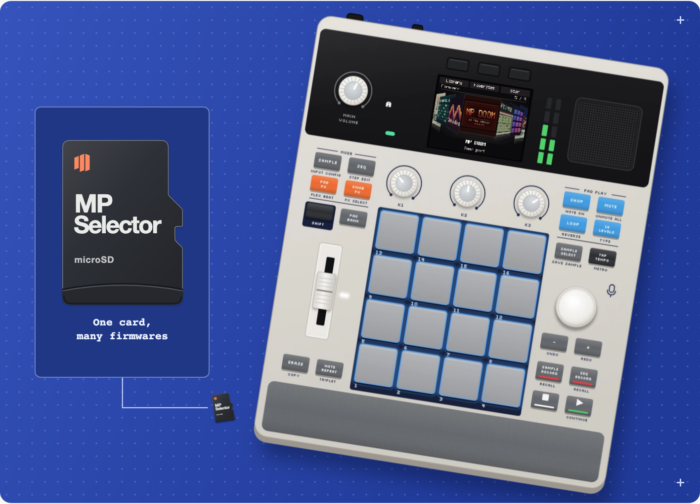
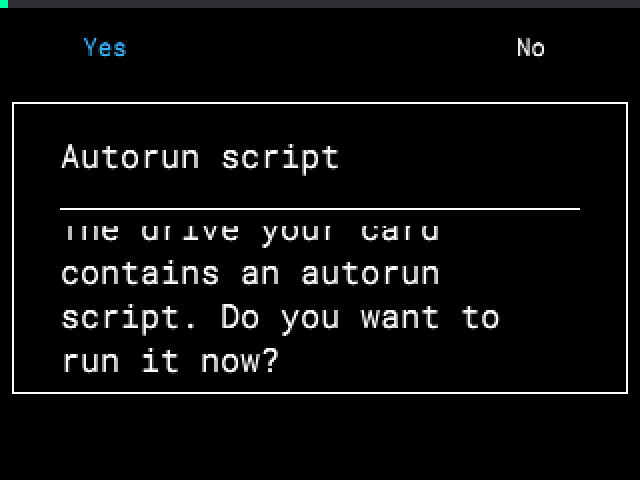
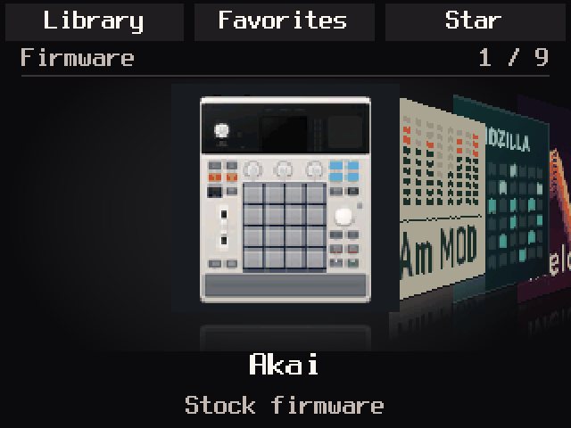
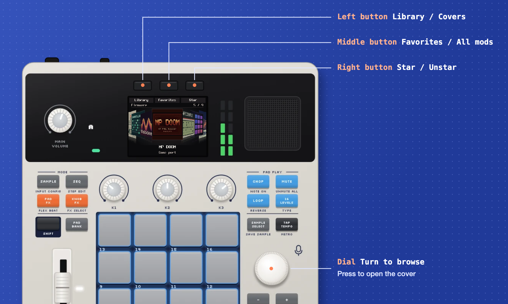
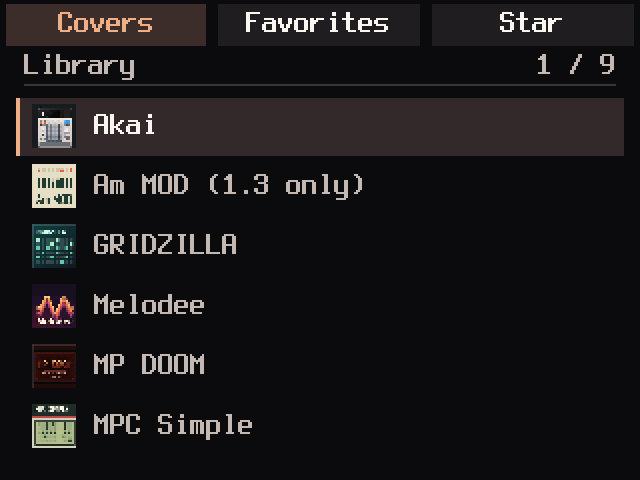
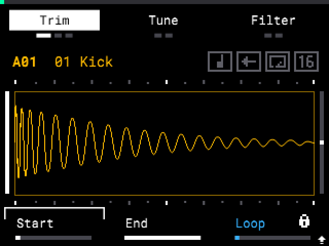
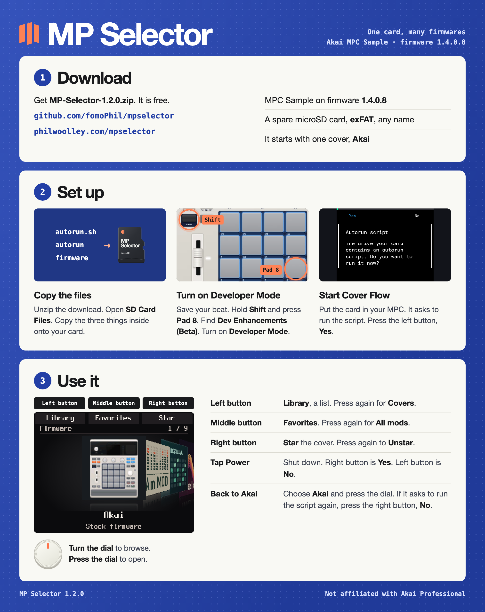

# MP Selector



Keep your favorite sampler mods and apps on one microSD card. Turn the dial on your Akai MPC Sample to pick what runs next. It starts from the card. Nothing is flashed.

By [Phil Woolley](https://philwoolley.com/mpselector/). Try the dial in your browser at [philwoolley.com/mpselector](https://philwoolley.com/mpselector/).

The whole thing on one page: [quick guide](docs/guide.png).

## Download

**[Download MP-Selector-1.2.0.zip](https://github.com/fomoPhil/mpselector/releases/latest/download/MP-Selector-1.2.0.zip)**

Tested on MPC Sample firmware **1.4.0.8**. The checksum is on the [release page](https://github.com/fomoPhil/mpselector/releases/latest).

The download has one cover, **Akai**. It does not include or install any other firmware. You [add your own](#add-firmware).

## Set up your card

You need a spare microSD card (exFAT). The card can have any name.

1. **Copy the files.** Unzip the download. Open `SD Card Files`. Copy the three things inside onto your card: `autorun.sh`, `autorun` and `firmware`.
2. **Turn on Developer Mode.** Save your beat first. On your MPC, hold **Shift** and press **Pad 8**. Find **Dev Enhancements (Beta)**. Turn on **Developer Mode**.
3. **Start Cover Flow.** Eject the card and put it in your MPC. The MPC asks to run the script. Press the left button, **Yes**.



The prompt shows your own card's name.

## Use it



These nine covers are on Phil's own demo card. Your MPC shows what is on your card.



| Control | What it does |
| --- | --- |
| Dial, turn | Browse the covers |
| Dial, press | Open the cover |
| Left button | **Library**, a list. Press again for **Covers** |
| Middle button | **Favorites**. Press again for **All mods** |
| Right button | **Star** or **Unstar** the cover |
| Power, tap | Shut down. Right button is **Yes**. Left button is **No** |

Your stars are saved when you open a cover or shut down.



## Go back to the Akai sampler

Choose **Akai** and press the dial. This opens the Akai sampler that is on your MPC. Phil tested it on 1.4.0.8.

If Akai asks to run the card script again, press the right button, **No**. That keeps you in Akai.



You can also shut down, take the card out and turn the MPC back on.

## Add firmware

MP Selector is the menu. It does not come with other firmware. You download a firmware from its maker and copy it onto your card. Needs MP Selector 1.2 or later.

1. Download the firmware from its own page and unzip it.
2. On your card, open `firmware` and make a new folder. Its name is what the MPC shows.
3. Copy everything from the download into that folder, as it is.

The firmware runs the way it would alone on a card. Folders it keeps at the top of a card, such as `MPC-Simple`, can stay inside its own folder.

For a cover, add a square picture named `cover.png` or `cover.jpg` to the same folder.

### Opened on Akai 1.4.0.8

Each of these was copied in unchanged and opened from Cover Flow on an MPC Sample running Akai 1.4.0.8.

| Firmware | Version |
| --- | --- |
| [Melodee](https://github.com/keremimo/melodee-sample/releases) | 0.8.3 |
| [MPC Simple](https://mpcsimple.com) | 1.0 Beta 11 |
| [Rhythmer OS](https://jazzyrhythmer.github.io/mpc-sample) | 0.3.0 |
| [hdslaveOS](https://github.com/hdslave/hdslaveOS) | 0.8.2-hdslave.3 |
| [EPICYCLE](https://github.com/tubedigga/EPICYCLE) | 0.3.6 |
| [MPC 600 S](https://github.com/LA-2500/MPC-600-S) | 2.0H |
| [MPCTRACKER](https://github.com/jeffwebb-to/mpc-sample-tracker) | 0.1.0 |
| [MPC Furnace](https://github.com/garrettjwilke/mpc-furnace) | 1.0.0 |
| [Beat-Train](https://github.com/drose030/beat-train-mpc-sample) | 1.6 |
| [MPC DOOM](https://github.com/jeffwebb-to/mpc-sample-doom) | 1.0.0 |
| [MPC Cave Story](https://github.com/garrettjwilke/mpc-cavestory) | 1.0.0 |
| [MPC TIC-80](https://github.com/garrettjwilke/mpc-tic80) | 1.0.0 |
| [MPC Gen1Recomp](https://github.com/garrettjwilke/mpc-gen1recomp) | 1.0.1 |

### Not on Akai 1.4 yet

- Tape Workshop and the sample-base demos check the Akai version themselves and stop on 1.4.0.8. They need an update from their makers.
- SampQOL OS, Am MOD, MaiaOS, KAOSAMPLE, MINIMOD, ArpeggiGator and similar mods change the Akai 1.3 app itself. On 1.4 their cover says "Requires Akai firmware 1.3.0.12" and nothing runs.

### If one does not open

After a minute with nothing on screen, Cover Flow comes back and says it did not start. Two things to try:

- Put an empty file named `sampleboot.inplace` in the firmware's folder, next to its `autorun.sh`. This is the same file SampleBoot uses.
- Check the firmware's own page for the Akai version it needs.

The [Add Firmware page](https://philwoolley.com/mpselector/add/) still sets up Melodee and MPC Simple so that quitting them returns to Cover Flow.

A firmware can also ship its own MP Selector folder. The page adds those too, whoever made them, and they open on MP Selector 1.1 or later. Developers: see [Make your firmware work with MP Selector](docs/DEVELOPERS.md).

If the page does not know a firmware, it tells you to copy it in as above.

Prefer a terminal? `node importer/cli.mjs <release.zip> <card folder>` does the same thing.

## Make your own cover

This part is for people who are comfortable with shell scripts.

Each cover is a folder inside `firmware` on the card. The folder's name is its ID.

| File | Needed | What it is |
| --- | --- | --- |
| `name` | Yes | The title shown on screen. First line only. |
| `run.sh` | Yes | The script that starts the firmware. |
| `cover.png` or `cover.jpg` | No | The cover art. A square picture. |
| `cover.rgb565` | No | The cover art as raw pixels. 96 × 96, RGB565, little-endian. Exactly 18,432 bytes. |
| `akai` | For a new folder | The Akai firmware versions it runs on, one per line. For example `1.4.0.8`. |
| `caption` | No | One short line under the title. Plain ASCII. |
| `unavailable` | No | One line. The cover shows this message and does not open. |
| `SHA256SUMS` | No | If it is there, every file is checked before the firmware starts. |

When you press the dial, MP Selector copies the folder into memory, because the card cannot run programs. It stops the Akai app and runs `sh ./run.sh <card path> <log file>` as root from that copy. Files whose names start with a dot are not copied. When the script ends, Cover Flow comes back.

**What opens on 1.4.0.8.**

- Any folder whose `akai` file lists `1.4.0.8`. The full rules are in [docs/DEVELOPERS.md](docs/DEVELOPERS.md).
- Folders named `mp-doom`, `pad-lights`, `melodee` and `mpc-simple`, with or without an `akai` file. `melodee` and `mpc-simple` also need a `SHA256SUMS` file that lists their files.
- A folder whose `akai` file lists only other versions shows "Requires Akai firmware" and the first version it lists. `sampqol` and `gridzilla` show that for 1.3.0.12.
- Any other folder shows "Not verified on Akai firmware 1.4" and stays in Cover Flow.

Version 1.0.1 opens only the four named folders.

## Firmware people use

| Project | Made by | Notes |
| --- | --- | --- |
| [MPC Simple](https://sourceforge.net/projects/mpcsimple/) | Mike Feedback | Load your samples and make a beat. |
| [Melodee](https://github.com/keremimo/melodee-sample) | Kerem | Make a song with up to 16 tracks. |
| [SampQOL OS](https://github.com/snarebes/SampQOL-OS) | snarebes | Adds up to 16 drum tracks, a step sequencer, a mixer with effects, 128-slice chop and stem export to the stock sampler. Free, in beta, made for firmware 1.3.0.12. |

These projects belong to their creators. MP Selector does not include them, install them or speak for them.

## If something goes wrong

- **You see the Akai sampler, not Cover Flow.** Check that your MPC is on 1.4.0.8 and Developer Mode is on. Save your work, then put the card in again.
- **No prompt appears.** Check that `autorun.sh` is at the top of the card, next to `autorun` and `firmware`.
- **Cover Flow shows only Akai.** That is normal on a new card. See [Add firmware](#add-firmware).

`START HERE.txt` in the download has the same steps.

## Build from source

The selector is a small C program for the MPC's screen, dial and buttons. It builds to a static ARM64 Linux binary with Zig 0.15.2. The exact compiler is recorded in [TOOLCHAIN.json](TOOLCHAIN.json).

```sh
python3 rebuild.py sd-files --zig /path/to/zig
```

This makes a new `sd-files` folder with the same files as `SD Card Files` in the download. Build on macOS or Linux.

| Folder | What is in it |
| --- | --- |
| `selector/` | Cover Flow, the launcher scripts and the Akai cover |
| `doom/` | Screen and control code shared with [MP DOOM](https://github.com/fomoPhil/mp-doom) |
| `importer/` | The source of the Add Firmware page, `Add Firmware.html`, with its pictures in `importer/art`. Rebuild it with `node importer/build.mjs`. `node importer/watch.mjs` checks each firmware's newest release against it |
| `docs/` | README images and the source of the quick guide |

The source for the compiler runtime and C library is in the `Source` archive inside the release ZIP.

## Quick guide



## License

MP Selector's code is GPL version 2 or later. See [LICENSE](LICENSE). The built-in Terminus font uses the SIL Open Font License. See [Licenses/Terminus.txt](Licenses/Terminus.txt). Notices for the C library and compiler runtime are in [Licenses/Runtime.txt](Licenses/Runtime.txt).

MP Selector is an independent project. It is not affiliated with Akai Professional.
